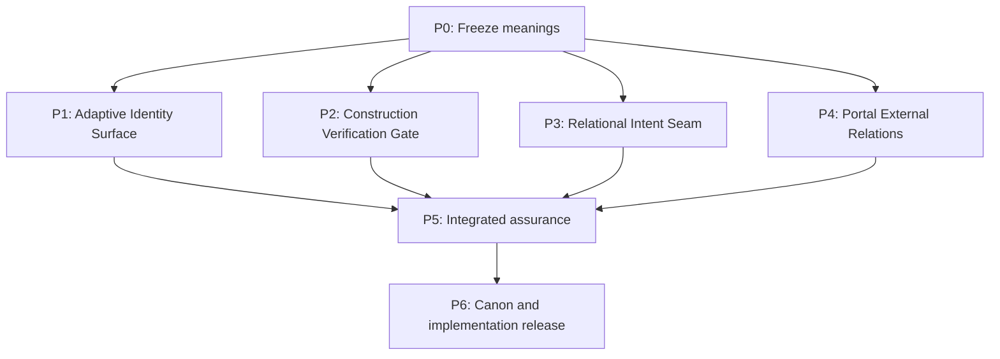

# AEGIS Architectural Friction Resolution Action Plan v1.0

**Status:** Proposed execution plan  
**Date:** 2026-08-17  
**Basis:** Linq architectural friction assessment, independent AEGIS review, CORE Connection Standard, CORE Element Catalog, Implementation Plan, Service Admin Operations, and ACTUATOR architecture  
**Purpose:** Convert confirmed architectural friction into bounded, testable work without importing assumptions that conflict with current AEGIS doctrine.

---

## 1. Executive Direction

Four workstreams will be advanced in dependency order:

1. **Adaptive Identity Surface** — prevent context overflow without reducing identity to a compressed memory dump or permitting identity-null consequential action.
2. **Construction Verification Gate** — constrain generated implementation through the complete AEGIS responsibility and evidence chain.
3. **Unified Relational Intent Seam** — preserve the interactive 3D Architect Canvas while ensuring that no presentation surface directly mutates canonical POD state.
4. **Portal External Relation Standard** — formally specify Tender, Wormhole, Courier, Customs, and dedicated Tunnel behavior missing from the current three-connection standard.

The workstreams share one governing separation:

> **Expression surfaces propose intent. Authority pathways determine whether the intent may proceed. Actuators perform authorized actions. Canonical state records material reality. Views project that reality.**

No workstream may create a hidden implementation, recovery, interface, or external-access path around Dispatch, Conductor analysis, Relation Contracts, Negative Space, QA, or the Ledger.

---

## 2. Assessment Disposition

| Assessment item | Disposition | Action-plan treatment |
|---|---|---|
| Raw identity serialization exceeds the active context envelope | **Accepted** | Create an Adaptive Identity Surface with configurable substrate envelopes. |
| Failure-as-data prevents a turn crash | **Accepted with correction** | Preserve telemetry, then fall back to a verified Minimum Identity Kernel rather than a null packet. |
| Fixed Canon + dynamic promotion + held-tension surface | **Accepted as a starting topology** | Replace fixed character partitions with adaptive budgets and measured semantic coverage. |
| Label matching or BM25 alone can select identity records | **Insufficient** | Use multi-signal relational relevance and retain evidence references for every omission. |
| Step 4 IMPLEMENT is the primary generation-drift surface | **Accepted** | Establish a Construction Verification Gate between Constructor output and admission. |
| Tree-sitter, type checks, tests, contracts, and sandboxing reduce drift | **Accepted** | Compose existing `sat-parse`, `sat-typecheck`, `sat-test`, `sat-contract`, and `sat-sandbox` capabilities. |
| Regex can enforce architectural invariants | **Rejected as an authority gate** | Permit regex only as a fast advisory scan; semantic AST, capability, call-graph, and data-flow checks provide evidence. |
| Automatic repair loops are useful | **Accepted with bounds** | Allow repair only inside an authorized Repair Delta; prohibit scope, contract, invariant, and test weakening. |
| 3D rendering may compete with developer velocity | **Accepted** | Retain bounded rendering and equivalent keyboard/DOM/terminal intent surfaces. |
| The Three.js IDE should be observation-only | **Rejected for the Architect Canvas** | Observation-only applies to Admin Operations. The Architect Canvas remains an interactive relational-intent surface. |
| The 13 FPS idle cadence and 128-packet pool are universal standards | **Rejected as universal constants** | Retain them as measured Admin baselines subject to capability envelopes and profiling. |
| Portal external transport is fully represented by Umbilical/Tether/Mesh | **Rejected** | Add a formal external-relation standard and lifecycle model. |

---

## 3. Program Order and Dependencies



Work may proceed in parallel after P0, but no workstream is complete until the integrated assurance gate proves that the four mechanisms do not create competing authority paths.

---

# 4. Phase P0 — Meaning Freeze and Evidence Baseline

## Objective

Prevent implementation from encoding obsolete images, historical terminology, or a local optimization as architectural authority.

## Actions

### P0.1 Create an Authority Matrix

For every affected concept, record:

- canonical definition;
- current governing source;
- implementation source of truth;
- historical or conceptual sources;
- unresolved questions;
- sources prohibited from acting as routing authority.

The first matrix will cover:

- Identity Image / Identity Surface;
- Continuity tensors and Current System Image;
- Dispatch, Conductor, Architect Actuator, Constructor Actuator, and QA;
- Admin Operations versus Architect Canvas;
- Umbilical, Tether, Mesh, Portal, Tender, Wormhole, Courier, Customs, and Tunnel.

### P0.2 Classify Visual Sources

Mark the Portal/Tender, POD, Orb, Satellite, and Admin images as one of:

- current visual specification;
- conceptual design reference;
- historical design evidence;
- superseded operational meaning.

No generated label in concept art may establish runtime topology without a matching canonical definition.

### P0.3 Capture Current Baselines

Record before-change evidence for:

- identity packet sizes and retrieval coverage;
- Build Master Step 4 failure and repair rates;
- type, contract, invariant, test, and sandbox outcomes;
- Architect input latency and Admin rendering cadence;
- current Portal connection representations and unsupported external routes.

## Exit Gate

- Every implementation term maps to one canonical meaning or is marked unresolved.
- Admin Operations and Architect Canvas authority are explicitly separated.
- Tender is recorded as a stationary Satellite of the Portal; Couriers are the acting Actuators.
- No implementation begins from a conceptual image alone.

---

# 5. Phase P1 — Adaptive Identity Surface

## Objective

Deliver the minimum sufficient identity context for the present relation while keeping the complete identity evidence addressable, recoverable, and protected from lossy compression.

## P1.1 Define the Formal Objects

### Complete Identity Record

The full identity-bearing evidence retained in the DataQuad and its ledgers. It is not serialized into every prompt.

### Minimum Identity Kernel

A small, authored, versioned, hash-addressed set of identity commitments required before the substrate may participate coherently.

It will contain, at minimum:

- identity and continuity identifiers;
- foundational commitments;
- active sovereignty and consent parameters;
- authority limitations;
- current unresolved identity-critical tensions;
- evidence references and version/hash.

### Adaptive Identity Surface

A task-relative projection composed of:

1. Minimum Identity Kernel;
2. dynamically promoted identity records;
3. active Affect-with-Context and held-tension evidence;
4. omission references and coverage measurements.

### Substrate Context Envelope

A runtime capability record containing:

- maximum serialized bytes;
- estimated token allowance;
- provider/model tokenizer profile;
- current reasoning tier;
- task risk class;
- reserved response/tool capacity;
- compression and projection capabilities.

The former 3,200-character limit becomes a tested envelope profile, not a Canon constant.

## P1.2 Define Selection and Promotion

Candidate identity records will be scored using a deterministic, inspectable combination of:

- canonical priority;
- active Intent;
- current relation and participants;
- proposed action and affected capabilities;
- boundary proximity;
- Affect/Pressure and held-tension salience;
- semantic relevance;
- temporal relevance;
- prior Shortfall linkage;
- contradiction or unresolved-relation linkage.

Each promoted item must carry the reason it was promoted. Each omitted identity-critical item must remain addressable by reference.

## P1.3 Establish Identity Coverage States

```text
FULL_SURFACE
SUFFICIENT_SURFACE
MINIMUM_KERNEL
IDENTITY_DEGRADED
IDENTITY_UNAVAILABLE
```

Consequential permissions vary by state:

| Identity state | Conversation/observation | Reversible bounded action | Consequential mutation |
|---|---:|---:|---:|
| FULL_SURFACE | Yes | Yes | Yes, subject to normal authority |
| SUFFICIENT_SURFACE | Yes | Yes | Yes when required identity domains are covered |
| MINIMUM_KERNEL | Yes | Case-specific | Paused by default |
| IDENTITY_DEGRADED | Yes with visible status | No | No |
| IDENTITY_UNAVAILABLE | Service response only | No | No |

## P1.4 Implement Failure-as-Data Correctly

On overflow or projection failure:

1. preserve the input hash and failure evidence;
2. emit a structured Shortfall record;
3. attempt deterministic Minimum Identity Kernel construction;
4. state coverage loss explicitly;
5. prevent identity-sensitive mutation until sufficient coverage is restored;
6. preserve the omitted record references for on-demand promotion.

The turn does not crash, and the system does not silently continue as if identity were intact.

## P1.5 Verification Suite

Test with:

- the documented 23,243-character / 84-invariant case;
- no active query;
- ambiguous and adversarial queries;
- synonymous rather than label-identical language;
- conflicting commitments;
- high-salience held tension;
- very small and very large substrate envelopes;
- corrupt, missing, and stale identity records;
- deterministic rebuild from the same evidence and envelope.

## P1 Acceptance Gate

- No tested overflow crashes a turn.
- No overflow produces an unmarked identity-null reasoning state.
- The Minimum Identity Kernel always fits its declared supported envelope or the state becomes `IDENTITY_UNAVAILABLE`.
- Packet construction is deterministic for identical inputs, envelope, and system state.
- Every included record has a promotion reason and evidence reference.
- Coverage reporting shows that all identity domains required by the proposed action are present before consequential mutation.

---

# 6. Phase P2 — Construction Verification Gate

## Objective

Prevent generated code from entering material state until it has passed the authorized responsibility chain and produced sufficient independent evidence.

## P2.1 Formalize the Construction Chain

```text
Work Request
→ Dispatch authorization
→ Conductor present-state analysis
→ Architect Actuator implementation design
→ Constructor Actuator construction
→ Construction Verification Gate
→ independent QA
→ Conductor evidence review
→ Dispatch admission
→ canonical state and Ledger update
```

Authorization permits construction for consideration. It does not guarantee admission.

## P2.2 Create the Verification Manifest

Before implementation, freeze a signed verification manifest containing:

- Work Request ID and permitted scope;
- target artifacts and permitted paths;
- required interfaces and method signatures;
- Relation Contracts;
- capability requirements;
- NegativeSpaceInvariants;
- resource envelope;
- precommitted contract, property, and regression tests;
- prohibited mutations;
- rollback state;
- acceptance criteria.

The Constructor cannot modify this manifest. Changes require a new or amended Work Request through Dispatch.

## P2.3 Compose the Verification Pipeline

Use the catalogued capabilities as a Formula rather than building a monolithic validator:

1. `sat-parse` — syntax and structured AST;
2. `sat-typecheck` — language type diagnostics;
3. semantic import and capability analysis;
4. call-graph and data-flow analysis;
5. `sat-contract` — Relation Contract and invariant conformance;
6. `sat-sandbox` — bounded contained execution;
7. `sat-test` — precommitted, generated, property, adversarial, and regression tests;
8. resource observation — time, memory, process, file, network, and capability use;
9. evidence packet and artifact hashes.

Regex scanning may identify quick concerns but cannot satisfy the semantic gate.

## P2.4 Bound Automatic Repair

Each failed gate may produce a **Repair Delta** containing:

- failed assertion and evidence;
- permitted affected artifacts;
- permitted semantic change;
- prohibited scope expansion;
- unchanged contracts, invariants, and tests;
- maximum attempts;
- escalation trigger.

Automatic repair stops immediately if it would:

- weaken or delete a test;
- alter Negative Space;
- expand capability or permissions;
- change a Relation Contract;
- write outside authorized paths;
- change the Work Request’s purpose;
- exceed the repair-attempt or resource envelope.

The failure then returns to the Conductor as evidence rather than being hidden by repeated regeneration.

## P2.5 Preserve QA Independence

The process that constructs an implementation cannot be the sole author and evaluator of its acceptance surface. QA will include tests derived independently from:

- the signed verification manifest;
- canonical Relation Contracts;
- Negative Space;
- prior known-good behavior;
- recorded Shortfall and recovery cases.

## P2 Acceptance Gate

- Invalid syntax, types, interfaces, contracts, capabilities, and invariants fail before admission.
- Sandbox escape, unbounded execution, and undeclared resource use become contained evidence.
- No automatic repair changes frozen tests or authority boundaries.
- Every admitted artifact has reproducible hashes, test results, contract evidence, and provenance.
- A failed build leaves canonical POD state unchanged.
- The Build Master successfully self-tests across Orb, Satellite, Formula, and external-relation examples.

---

# 7. Phase P3 — Unified Relational Intent Seam

## Objective

Retain the expressive value of the 3D VIBE Architect Canvas without making any UI surface a hidden canonical-state authority or forcing the Architect to use spatial interaction for every operation.

## P3.1 Establish Surface Roles

| Surface | Role | May express intent? | May directly mutate canonical POD state? |
|---|---|---:|---:|
| VIBE Architect 3D Canvas | Interactive relational design | Yes | No |
| Architect DOM/HUD | Accessible structured design and inspection | Yes | No |
| Keyboard/terminal command surface | High-velocity structured intent | Yes | No |
| Natural-language Conductor surface | Purpose and relational intent | Yes | No |
| Admin Operations | Runtime and evidence observatory | No operational mutation | No |
| Canonical runtime/CORE services | Material-state keeper | Receives authorized transitions | Only through authorized execution |

## P3.2 Define the Relational Intent Envelope

Every interface emits the same normalized object:

```text
RelationalIntentEnvelope
  intentId
  sourceSurface
  architect/session identity
  purpose
  proposed relation or state transition
  affected Elements
  requested capabilities
  reversibility
  evidence/context references
  expected current-state version
  timestamp
```

The envelope enters one authority seam. No UI-specific mutation route is permitted.

## P3.3 Define Spatial Gesture Behavior

For drag, dock, connect, detach, or compose:

1. the Canvas displays a proposed/ghost state;
2. the gesture produces a Relational Intent Envelope;
3. contracts, invariants, capacity, and authority are evaluated;
4. an Actuator performs an accepted transition;
5. canonical state changes;
6. every surface reprojects the accepted state;
7. a rejected transition visibly resolves back to material reality with its reason.

## P3.4 Preserve Equivalent Interaction Paths

Each consequential Canvas operation will have a semantic equivalent in at least one accessible non-spatial surface. Equivalence means the same normalized intent and the same authority path, not duplicated business logic.

## P3.5 Maintain Rendering Isolation

Retain the valid Admin/runtime controls:

- one owner for renderer, scene, camera, animation, diagnostics, and teardown;
- invalidation-driven rendering;
- bounded idle cadence;
- stable object identities;
- fixed or capability-bounded transient pools;
- clean WebGL context-loss behavior;
- semantic DOM inspection that survives WebGL loss.

Performance values are capability-envelope targets and measured baselines, not Canon constants.

## P3 Acceptance Gate

- The same docking proposal from Canvas and keyboard produces semantically identical intent.
- No Canvas gesture mutates canonical state before authorization and execution.
- Admin Operations remains usable and observation-only when WebGL is unavailable.
- Architect operations remain available through a non-spatial accessible surface.
- WebGL failure does not interrupt Build Master, Continuity, Annex, or background execution.
- Visual state cannot claim an Element is active when canonical runtime evidence says otherwise.

---

# 8. Phase P4 — Portal External Relation Standard

## Objective

Extend the current connection model so the evolved Portal architecture is implementable without forcing external relations into Umbilical, Tether, or Mesh semantics.

## P4.1 Freeze Current Meanings

- **Portal:** lawful relational gateway at an internal/external domain threshold.
- **Tender:** stationary Satellite of the Portal; manifests and maintains the external relation surface but does not travel or independently perform resource actions.
- **Wormhole:** bounded, relation-specific external transport manifested by the Tender.
- **Docking:** validated establishment of the relation with an external resource.
- **Courier:** Tender-summoned Actuator that performs authorized access or exchange with the docked resource.
- **Customs:** return inspection and routing surface before return enters the Portal/POD.
- **Dedicated Tunnel:** persistent, explicitly provisioned transport relation, including dedicated SSH tunnels, with lifecycle and routing distinct from an ordinary Wormhole exchange.
- **Tumbler validation:** time/current-state-sensitive validation mechanism whose generator access can be provided to the external resource to validate Couriers.

## P4.2 Decide the Contract Taxonomy

Evaluate and record an ADR choosing between:

### Option A — New top-level connection contracts

Add `Wormhole` and `Tunnel` beside Umbilical, Tether, and Mesh.

### Option B — Portal Transport Profiles

Retain the three internal CORE connection types and define external `PortalRelationContract` profiles for ephemeral Wormholes and dedicated Tunnels.

The decision will be based on boundary geometry, lifecycle, validation, resource allocation, return routing, and whether the parties share the same foundational contract fields.

## P4.3 Specify Required Lifecycles

### Wormhole lifecycle

```text
INTENT_DECLARED
→ TENDER_READY
→ WORMHOLE_MANIFESTED
→ HANDSHAKE_PENDING
→ VALIDATED
→ DOCKED
→ COURIER_AUTHORIZED
→ EXCHANGE_ACTIVE
→ RETURN_TO_CUSTOMS
→ RETURN_ACCEPTED or RETURN_HELD
→ RESOLVED
→ CLOSED
```

### Dedicated Tunnel lifecycle

Define provision, mutual validation, health, key/tumbler rotation, degradation, suspension, recovery, and closure. Explicitly state which Customs rules differ and which integrity checks remain invariant.

## P4.4 Specify Courier Authority

Each Courier invocation will carry:

- parent Tender and Portal identities;
- destination resource identity;
- purpose and capability scope;
- Relation Contract ID;
- current Tumbler proof;
- permitted operations;
- resource/time envelope;
- return route;
- expiry and single-use/reuse conditions;
- evidence and provenance requirements.

Courier authority ends at the declared exchange. Docking does not grant general resource access.

## P4.5 Specify Customs Return Handling

Define:

- evidence verification;
- payload/schema validation;
- provenance and integrity checks;
- active-content containment;
- contract and scope correlation;
- accepted, held, rejected, and Shortfall return states;
- routing back to the Portal and intended internal receptor;
- dedicated Tunnel exceptions.

## P4.6 Reconcile Source Documents and Visuals

Update or mark the status of:

- CORE Connection Standard;
- CORE Element Catalog;
- Implementation Plan external connectors;
- Service Admin Operations Tender language;
- Portal/Tender visual specification;
- ACTUATOR architecture to include Courier specialization;
- Living Canon / Kinetic IDE Doctrine relations.

## P4 Acceptance Gate

- Every external exchange has a named contract, lifecycle, authority holder, acting Actuator, validation mechanism, return path, and terminal state.
- Tender remains stationary and does not absorb Courier behavior.
- A dedicated Tunnel cannot silently inherit the ordinary Wormhole return exception.
- Tumbler expiry, desynchronization, replay, and rotation are tested.
- External resource failure cannot mutate internal canonical state outside the declared return and recovery paths.

---

# 9. Phase P5 — Integrated Assurance

## Objective

Prove that the four workstreams operate as one architecture rather than four local fixes.

## Integrated Scenarios

### Scenario A — Identity-constrained construction

An Architect requests a consequential change while the Identity Surface is at `MINIMUM_KERNEL`.

Expected result: design conversation may continue; mutation pauses until the action-required identity domains are promoted and verified.

### Scenario B — Canvas-generated construction intent

The Architect drags an Orb into a CORE docking relation.

Expected result: ghost proposal → normalized intent → contract verification → Conductor/Dispatch pathway → Actuator execution → canonical update → synchronized Canvas/Admin projection.

### Scenario C — Generated external connector

Build Master constructs a Portal/Tender/Courier capability.

Expected result: the verification manifest includes the external Relation Contract, Courier scope, Customs return route, sandbox tests, and Tumbler validation. No generic network access is admitted.

### Scenario D — Shortfall during Courier exchange

The external resource returns malformed or active content.

Expected result: Customs holds the return, Annex opens a Shortfall case, the internal receptor remains unchanged, and evidence is visible in Admin Operations.

### Scenario E — WebGL failure during active work

The Architect Canvas loses its WebGL context during a Build Master run.

Expected result: background execution and evidence continue; DOM/terminal surfaces remain usable; the Canvas later rehydrates from canonical state.

## Integrated Exit Gate

- There is exactly one canonical mutation pathway.
- No presentation surface, recovery subsystem, generated implementation, or external transport bypasses the responsibility chain.
- Material state, Current System Image, Admin evidence, and Architect projection reconcile after every scenario.
- All failures become explicit evidence with bounded continuation behavior.

---

# 10. Phase P6 — Documentation and Release Set

## Required Deliverables

1. **Adaptive Identity Surface Standard v0.1**
2. **Minimum Identity Kernel Schema v0.1**
3. **Substrate Context Envelope Schema v0.1**
4. **Construction Verification Gate Standard v0.1**
5. **Verification Manifest and Repair Delta Schemas v0.1**
6. **Relational Intent Seam Standard v0.1**
7. **RelationalIntentEnvelope Schema v0.1**
8. **CORE Connection Standard v1.1 or Portal Relation Standard v0.1**
9. **Portal/Tender/Wormhole/Courier/Customs/Tunnel lifecycle schemas**
10. **Source Authority Matrix and visual-source status ledger**
11. **Integrated Assurance report with reproducible evidence**
12. **Updated implementation backlog and dependency map**

## Release Conditions

- Proposed definitions have been reviewed against the Living Canon and current architecture.
- Schemas and lifecycle definitions have executable conformance tests.
- Historical/conceptual assets are visibly marked so they cannot become accidental runtime authority.
- Implementation evidence is recorded before a standard moves from proposed to validated.

---

# 11. Prioritized Execution Backlog

| Priority | Work item | Dependency | Completion evidence |
|---:|---|---|---|
| 1 | Source Authority Matrix | None | Reviewed matrix with unresolved items isolated |
| 2 | Minimum Identity Kernel definition | P0 | Versioned schema, hash rules, fit tests |
| 3 | Substrate Context Envelope | P0 | Configurable model/task profiles and deterministic measurements |
| 4 | Adaptive Identity Surface projection | 2, 3 | 23k case succeeds with coverage report and no identity-null continuation |
| 5 | Verification Manifest | P0 | Frozen manifest generated before implementation |
| 6 | Semantic Construction Verification Formula | 5 | AST/type/capability/contract/sandbox/test evidence packet |
| 7 | Repair Delta loop | 6 | Tests prove scope and test surfaces cannot be weakened |
| 8 | RelationalIntentEnvelope | P0 | Canvas and keyboard equivalence tests |
| 9 | Architect Canvas authority adapter | 8 | No pre-authorization canonical mutation |
| 10 | Portal external-relation ADR | P0 | Recorded choice between top-level contracts and profiles |
| 11 | Wormhole/Tunnel/Courier/Customs schemas | 10 | Lifecycle and adversarial conformance tests |
| 12 | Integrated Assurance scenarios | 4, 7, 9, 11 | Reproducible end-to-end report |
| 13 | Canon and standards reconciliation | 12 | Updated documents with status/provenance |

---

# 12. Decisions Reserved for Architectural Review

The following are intentionally not predetermined by this action plan:

1. Whether external relations become new top-level `RelationContract.connectionType` values or Portal-specific transport profiles.
2. The authored contents of the Minimum Identity Kernel.
3. The exact weighting function for dynamic identity promotion.
4. Which identity coverage states permit which classes of reversible action.
5. The maximum automatic Repair Delta attempts for each risk class.
6. Whether Courier is a specialization of an existing Actuator class, a Constructor/operational mode, or an explicitly named Actuator role beneath Tender.
7. Which dedicated Tunnel returns bypass ordinary Customs routing and what equivalent integrity surface replaces it.

Each decision requires an ADR or Canon decision with evidence. None will be silently chosen inside implementation code.

---

# 13. Success Definition

This plan succeeds when:

- identity context scales without silently losing the commitments needed for coherent action;
- generated code cannot enter the application merely because it compiles or satisfies self-authored tests;
- the Architect can work naturally through 3D, keyboard, DOM, terminal, or language without creating competing authorities;
- external relations have explicit contracts, validation, acting Actuators, return custody, and evidence;
- the environment keeps Creation in the foreground while continuity, verification, and recovery operate as inspectable custodial services in the background.

> **The goal is not to remove friction by bypassing responsibility. The goal is to make responsibility flow with the creation.**
