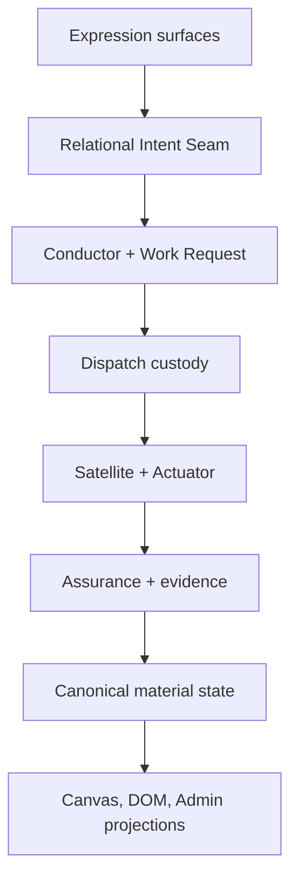
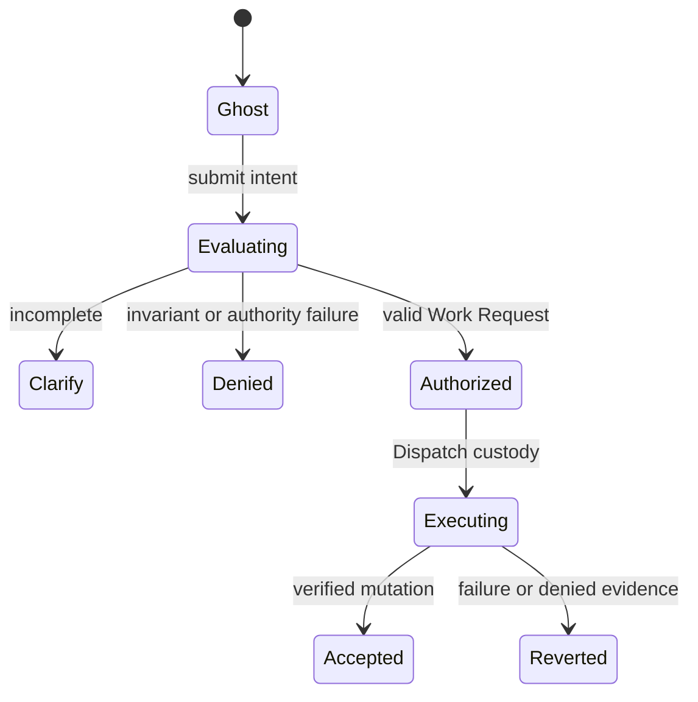
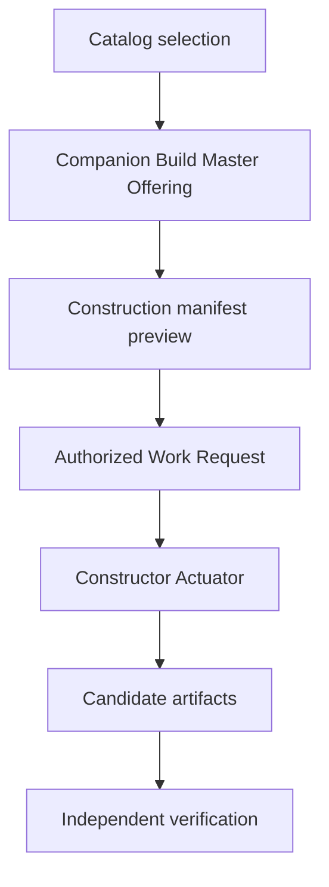

# AEGIS VIBE Architect IDE Modification Implementation Plan v1.0

**Status:** Proposed execution plan  
**Date:** 2026-08-17  
**Scope:** Canon-aligned integration of the Antigravity Spatial Canvas, dynamic conduits, catalog-driven construction, active Companion, construction verification, Continuity Capsule/Tumbler flow, and external Portal relations.

## 1. Executive Decision

The useful Linq/Gemini work should be adopted as a **prototype and architectural input**, not merged unchanged.

The target IDE will provide:

- a spatial Antigravity Canvas that expresses relational intent without directly mutating canonical state;
- an active Companion that offers contextual help but never silently performs mutations;
- catalog-driven generation for the complete CORE element set;
- independently verified construction through Work Request Contracts, manifests, evidence, bounded repair, and Assurance;
- dynamic conduits whose topology, lifecycle, pressure, and packet motion are derived from runtime evidence;
- resilient continuity through Continuity Capsules, Customs, Tumbler validation, and explicit recovery paths;
- equivalent DOM, keyboard, natural-language, and spatial interaction paths;
- WebGL as an optional projection layer rather than an authority or availability dependency.

The main architectural correction is this:

> **The Canvas proposes. The Conductor authorizes. Dispatch routes. Satellites host bounded processes. Actuators perform. Assurance verifies. Canonical state records. Projections display.**

## 2. What Is Adopted, Adapted, or Rejected

| Contribution | Disposition | Implementation treatment |
| --- | --- | --- |
| Antigravity 3D spatial stage | Adopt | Make it a projection and intent-expression surface backed by canonical snapshots. |
| Procedural conduit splines | Adopt | Drive geometry and visual state from connection contracts and evidence, not hardcoded props. |
| Drag-based node positioning | Adapt | Drag creates a ghost proposal; commit occurs only after intent evaluation and authorized execution. |
| GLB-backed element actors | Adopt | Add safe scene cloning, animation adapters, lifecycle cleanup, fallback representations, and asset budgets. |
| Active Companion presence | Adopt | Implement proactive Offerings with attunement and consent; keep mutation authority outside the Companion. |
| Build Master user workflow | Adopt | Preserve the name at the experience layer; route actual generation through a Constructor Actuator. |
| Automated catalog scaffolding | Adopt | Parse a normalized, versioned catalog rather than duplicating a hardcoded partial list. |
| Generated contracts, fixtures, and tests | Adapt | Generate declared candidates plus verification inputs; do not treat generator output as verified. |
| `verified_by: build-master` | Reject | Verification is an independent Assurance result supported by evidence hashes. |
| Hardcoded nine-element catalog | Reject | The catalog source is normalized and coverage-gated against the canonical catalog. |
| Full 76-entry Build Master expansion | Adapt | It improves nominal coverage, capability arrays, UTF-8 handling, and path construction, but remains a duplicated catalog and retains authority/topology/profile defects. |
| Satellite-to-CORE tether | Reject | A Tether connects a Satellite to its Host Orb. Invalid topology fails closed. |
| Clock-driven packet animation | Reject | Packets visualize actual operation/evidence events; idle connections do not fabricate traffic. |
| Per-conduit “128-pool proxy” mesh | Reject | Use a real shared `InstancedMesh` packet pool with allocation and release semantics. |
| UI-owned element positions as truth | Reject | Maintain separate proposal, material, and view state. |
| WebGL-only interaction | Reject | Every operation retains an equivalent accessible interaction path. |
| Unbounded automatic repair | Reject | Repair is a declared, reviewable `RepairDelta` constrained by the Work Request. |

## 3. Governing Boundaries

### 3.1 Source authority

Before implementation, register a source-authority matrix:

1. Living Canon and approved architecture decisions.
2. Versioned standards and schemas.
3. Executable contracts and verified runtime behavior.
4. Implementation plans and operational documentation.
5. Visual references and prototypes.

Lower-ranked material can reveal intent or friction, but cannot silently supersede higher-ranked meaning.

### 3.2 State separation

The IDE will keep three state families distinct:

| State family | Purpose | Authority |
| --- | --- | --- |
| `MaterialState` | Accepted elements, relations, contracts, operations, evidence, and versions | Canonical services only |
| `ProposalState` | Ghost nodes, candidate relations, pending moves, previews, and repair deltas | Session-scoped intent workflow |
| `ViewState` | Camera, selection, panels, filters, semantic zoom, and local layout preferences | Client projection |

No reducer, Three.js component, DOM control, keyboard handler, or Companion Offering may write `MaterialState` directly.

### 3.3 Connection topology

| Contract | Valid parties | Boundary crossed |
| --- | --- | --- |
| Umbilical | Element ↔ CORE | CORE boundary |
| Tether | Satellite ↔ Host Orb | Orb boundary |
| Mesh | Satellite ↔ Satellite | Shared service boundary |
| Portal transport profile | Pod-side Portal/Tender flow ↔ external domain | External trust boundary |

Portal transport remains an architectural decision record: either extend the top-level contract taxonomy or model Wormhole/Dedicated Tunnel as profiles composed over approved contracts. Implementation does not invent a fourth connection type before that decision.

### 3.4 Mutation and verification

- Companion, Canvas, DOM, keyboard, and natural language express intent.
- The Conductor establishes or authorizes a Work Request Contract.
- Dispatch owns routing and custody of work in transit.
- A stationary Satellite hosts the bounded specialized process.
- An Actuator performs the authorized action.
- Assurance evaluates independently from the generator and performer.
- Failed invariants sever or suspend the relation according to the applicable lifecycle; they never degrade into silent permission.

## 4. Target Architecture



### 4.1 Proposed package boundaries

Paths below are target boundaries and should be mapped to the production repository during Phase 0.

```text
packages/
  contracts/        # Versioned schemas and lifecycle contracts
  intent/           # Relational Intent Seam and surface adapters
  catalog/          # Catalog parser, normalized model, coverage reports
  construction/     # Constructor Actuator and scaffold generators
  assurance/        # Independent verification pipeline and evidence
  continuity/       # Capsule, Customs, Tumbler, recovery policy
  operations/       # Runtime operation/event projection adapters
  companion/        # Presence, Offerings, attunement, consent
  spatial-runtime/  # Three.js projection, actors, conduits, packet pool
apps/
  vibe-architect/   # Accessible IDE shell and integration composition
scripts/
  build_master.py   # Transitional CLI facade only
```

## 5. Phased Implementation

### Phase 0 — Meaning Freeze, Baseline, and Decisions

**Goal:** Prevent prototype code or visuals from becoming accidental authority.

Actions:

1. Create the source-authority matrix and register all supplied materials.
2. Capture current IDE route, bundle, test, accessibility, and runtime baselines.
3. Inventory current repositories, packages, state stores, APIs, event streams, and Three.js assets.
4. Record architecture decisions for:
   - Portal contract taxonomy;
   - canonical position ownership versus session layout preference;
   - Stellar generation profile and truthful claim boundary;
   - capability/resource envelope representation;
   - connection lifecycle vocabulary;
   - Companion Offering persistence and consent policy.
5. Freeze the exact negative-space invariant vocabulary used by generated artifacts.

Deliverables:

- `SOURCE_AUTHORITY_MATRIX.md`
- architecture decision records;
- baseline report;
- repository path mapping for this plan.

Exit gate: every implementation source has an owner, authority rank, version, and conflict rule.

### Phase 1 — Canonical Contracts and State Model

**Goal:** Establish stable seams before UI or generator integration.

Implement versioned schemas for:

- `ElementDefinition` and `ElementRef`;
- `RelationContract` and lifecycle projection;
- `RelationalIntentEnvelope`;
- `WorkRequestContract`;
- `ConstructionVerificationManifest`;
- `RepairDelta`;
- `OperationEvent` and `EvidencePacket`;
- `ContinuityCapsule` and Tumbler decision;
- `Offering` and consent disposition;
- `MaterialState`, `ProposalState`, and `ViewState`.

Minimum `RelationalIntentEnvelope` fields:

```text
intentId, sourceSurface, actor/session identity, purpose,
proposed relation or state transition, affected element refs,
requested capabilities, reversibility, evidence refs,
expected current version, timestamp
```

Add schema migrations, canonical serialization, content hashing, optimistic version checks, and replay-safe identifiers.

Exit gate: schema fixtures round-trip deterministically and invalid topology, authority, capability, version, and invariant cases fail closed.

### Phase 2 — Unified Relational Intent Seam

**Goal:** Make all interaction surfaces equivalent translators of intent.

Actions:

1. Implement one intake API for Canvas, DOM, keyboard, natural language, and Companion proposals.
2. Normalize each proposal into a `RelationalIntentEnvelope`.
3. Evaluate current version, authority, capability fit, resource envelope, invariants, and reversibility.
4. Display evaluation as accepted, needs clarification, denied, or stale.
5. On acceptance, create or bind the Work Request and send it into Dispatch custody.
6. Reproject canonical results to all surfaces after execution.

Required interaction flow:



Exit gate: equivalent gestures from spatial, DOM, keyboard, and natural-language surfaces produce semantically equivalent envelopes and outcomes.

### Phase 3 — Catalog Normalization and Coverage

**Goal:** Turn `CORE_ELEMENT_CATALOG.md` into a versioned input, not an implementation-time constant.

Actions:

1. Parse the catalog into a normalized machine-readable form.
2. Validate identifiers, categories, connection eligibility, capabilities, host requirements, and provenance.
3. Produce a human-readable coverage report.
4. Gate on expected category totals and unique IDs without relying solely on the headline count.
5. Represent unresolved fields explicitly as `unresolved` or `provisional`; do not invent defaults.
6. Require a reviewed catalog change to alter generated outputs.

Components:

- `CatalogParser`
- `CatalogSchema`
- `CatalogNormalizer`
- `CatalogCoverageReport`

Exit gate: the normalized catalog is deterministic, complete relative to the authoritative source, and emits actionable diagnostics for ambiguity.

### Phase 4 — Build Master Reframe and Constructor Pipeline

**Goal:** Preserve the valuable Build Master workflow while correcting its authority model.

User-facing flow:



Implementation actions:

1. Retain `scripts/build_master.py` temporarily as a compatibility facade.
2. Remove the hardcoded nine-element catalog.
3. Route generation through a `CatalogScaffoldGenerator` invoked by a Constructor Actuator.
4. Generate into an isolated staging directory using atomic writes.
5. Precompute the intended file set and reject undeclared paths.
6. Attach Work Request ID, generator version, source hashes, catalog version, and manifest hash.
7. Generate candidate contracts, fixtures, test skeletons, and provenance—never self-verification.
8. Use host-Orb references for Satellite Tethers and explicit Portal profiles for external connectors.
9. Derive resource constraints from the selected substrate/capability envelope; remove universal hardcoded limits.
10. Generate Stellar only against an approved language profile. Otherwise emit an intermediate contract model and mark Stellar output unavailable.

Exit gate: repeated runs with the same inputs are byte-deterministic, cannot escape the declared staging root, and never label output verified.

#### Disposition of `build_master_full_76(1).py`

The expanded script is a useful coverage prototype, but it is not yet the production generator:

- Positive changes to retain: all four catalog groups are represented; capabilities are normalized into arrays; output paths use `os.path.join`; files use UTF-8; output categories remain easy to inspect.
- Remaining blockers: the catalog is still manually duplicated; `verified_by: build-master-76` still self-verifies; every generated test still connects `partyB` to `core-crystal`; `composed` and `portal` are emitted as connection types despite the current connection standard; Portal network permission becomes a broad category switch; resource values and the 3,200-character limit remain invented global defaults; generated tests cover only a shared happy path; writes are neither staged nor atomic; source and output hashes are absent.
- Migration use: treat the 76-entry list as a comparison fixture for `CatalogCoverageReport`, then retire it after normalized catalog ingestion reaches parity.

### Phase 5 — Construction Verification Gate

**Goal:** Make “built” and “accepted” distinct states.

The `ConstructionVerificationManifest` will declare:

- Work Request ID and authorized scope;
- target paths and allowed mutations;
- interfaces, relation contracts, capabilities, and resources;
- exact invariants and prohibited mutations;
- precommitted tests and evidence requirements;
- rollback procedure;
- acceptance criteria.

Verification pipeline:

1. Parse and schema validation.
2. Typecheck and build.
3. Semantic capability and topology validation.
4. Static call/data-flow inspection where applicable.
5. Relation-contract conformance.
6. Sandbox and resource-envelope checks.
7. Unit, contract, integration, and negative-path tests.
8. Artifact/evidence hashing and provenance binding.
9. Independent Assurance disposition.

Repair policy:

- Repairs are explicit `RepairDelta` objects.
- Each delta names the failing criterion, affected paths, proposed edits, evidence, and rollback.
- Repair cannot broaden scope, relax invariants, change identity, or self-approve.
- Exhausted repair attempts return a Shortfall with preserved evidence.

Exit gate: a generator cannot promote its own trust state, and every accepted artifact traces to independent evidence.

### Phase 6 — Antigravity Canvas Integration

**Goal:** Convert the supplied TSX prototype into a truthful, accessible projection.

#### `AntigravityStage.tsx`

- Replace local hardcoded nodes with `ArchitectTopologySnapshot` data.
- Render valid relations from canonical connection projections.
- Keep proposal positions in `ProposalState`; do not treat drag coordinates as material truth.
- Add semantic zoom, selection, focus, filters, and stable camera persistence in `ViewState`.
- Suspend OrbitControls during drag and restore them reliably.
- Provide error boundaries, loading states, reduced-motion behavior, and a WebGL-loss fallback.
- Lazy-load the spatial runtime and GLB assets.

#### `RiggedElementActor.tsx`

- Implement actual pointer/drag behavior with a declared drag plane or constrained spatial manipulator.
- Clone loaded GLTF scenes per actor to avoid shared mutable scene graphs.
- Map canonical lifecycle and operation states through an animation adapter rather than using three hardcoded states.
- Keep micro-float purely visual and separate from the actor’s proposed/material position.
- Add focus/selection semantics and an equivalent DOM inspector/action path.
- Dispose cloned resources and animation actions safely.

#### `ConduitSpline.tsx`

- Accept a connection projection containing contract ID, type/profile, lifecycle, pressure, direction, and evidence status.
- Derive curve control points from endpoint ports and routing constraints.
- Replace unreliable `lineBasicMaterial.linewidth` usage with `Line2` or tube geometry where thickness matters.
- Dispose replaced geometries/materials.
- Remove the per-line pulse sphere and time-fabricated motion.

#### New spatial components

- `GhostElementActor`
- `ProximityDockingGuide`
- `ConnectionProposalOverlay`
- `OperationPacketPool`
- `WebGLFallbackTopology`
- `SpatialAccessibilityBridge`

Exit gate: dragging never mutates canonical state directly; accepted and rejected proposals are visually and semantically distinct; loss of WebGL does not block work.

### Phase 7 — Truthful Dynamic Conduit Runtime

**Goal:** Make flow visualization an evidence projection rather than decoration.

Actions:

1. Introduce a connection projection adapter from relation contracts and operation events.
2. Define visual tokens for proposed, handshaking, active, degraded, suspended, severed, and stale states.
3. Implement a shared instanced packet pool with bounded allocation, release, priority, and overflow telemetry.
4. Animate packets only from real transit/evidence events.
5. Render direction, payload class, custody stage, pressure, freshness, and assurance status without exposing protected payload contents.
6. Aggregate or simplify flows at semantic zoom levels.
7. Keep the Service Admin trace and Antigravity projection consistent while preserving their different purposes.

Performance gates:

- no unbounded object creation per frame;
- no React state updates in the render loop for animation-only changes;
- bounded packet pool and draw-call budget;
- frame-time and memory telemetry under declared reference scenes;
- graceful reduced-fidelity mode under resource pressure.

Exit gate: paused event streams produce no fabricated traffic, lifecycle changes are replayable, and visual state matches the evidence ledger.

### Phase 8 — Active Companion and Build Master Experience

**Goal:** Make the Companion genuinely present without giving it concealed authority.

Components:

- `CompanionPresenceDaemon`
- `ContextProjection`
- `AttunementPolicy`
- `OfferingComposer`
- `OfferingStore`
- `ConsentDisposition`

Offering lifecycle:

`OBSERVED → COMPOSED → OFFERED → ACCEPTED | DISMISSED | EXPIRED → EXECUTED | FAILED`

Actions:

1. Observe only permitted, minimum-sufficient context.
2. Form contextual Offerings with purpose, scope, reversibility, expected effect, and evidence.
3. Let the Architect accept, modify, dismiss, defer, or ask for clarification.
4. Translate accepted Offerings through the same Relational Intent Seam as every other surface.
5. Make Build Master a named Companion Offering that previews generation and verification scope.
6. Prevent repeated or attention-seeking Offerings through attunement, cooldown, relevance, and quiet-mode policies.

Exit gate: no Companion action bypasses the intent, Work Request, execution, evidence, or Assurance chain.

### Phase 9 — Continuity Capsule, Customs, and Tumbler Integration

**Goal:** Preserve identity and evidence across pauses, handoffs, retries, and external return paths.

Actions:

1. Bind Continuity Capsules to Work Request, material version, responsibilities, evidence, unresolved questions, and environment context.
2. Validate integrity, freshness, expected version, authority, and minimum sufficient context through the Tumbler.
3. Route external returns through Customs before Tumbler validation and target reintegration.
4. Reject stale, overbroad, incomplete, or identity-mutating capsules with structured reasons.
5. Support explicit resume, reconcile, supersede, quarantine, and discard dispositions.
6. Project continuity status to Canvas, Companion, and Admin without exposing protected contents.

Exit gate: interrupted work resumes reproducibly, stale capsules cannot overwrite newer material state, and every disposition is evidenced.

### Phase 10 — Portal External Relations

**Goal:** Implement external exchanges without weakening internal contracts.

Actions after the Phase 0 ADR:

1. Implement Portal, stationary Tender Satellite, Wormhole lifecycle, docking, Courier Actuator, Customs, Tumbler, and dedicated tunnel semantics.
2. Separate credentials and secrets from relation/evidence payloads.
3. Make external capability, rate, budget, consent, and data-boundary policies explicit.
4. Model retries, partial returns, remote shortfalls, revocation, and credential expiry.
5. Add connector simulations before live provider adapters.

Exit gate: an external connector cannot bypass Tender stewardship, Customs, Tumbler validation, evidence capture, or target-version checks.

### Phase 11 — Integrated Assurance and Release

**Goal:** Verify the complete relational IDE, not isolated components.

Required end-to-end scenarios:

1. Spatial drag creates a ghost, an intent, an authorized relation, verified execution, and canonical reprojection.
2. Keyboard, DOM, and natural-language equivalents produce the same semantic result.
3. Build Master selects catalog entries, previews a manifest, generates candidates, fails one test, applies a bounded repair, and receives independent Assurance.
4. Invalid Satellite-to-CORE Tether is denied before execution.
5. Stale expected version creates clarification or rejection, never last-write-wins mutation.
6. Runtime event packets appear on the correct conduit and stop when evidence stops.
7. WebGL loss during active work preserves DOM operations and canonical state.
8. Continuity Capsule resumes after interruption and rejects stale reintegration.
9. Portal return passes Customs and Tumbler before target integration.
10. Companion Offering is accepted, edited, dismissed, expired, and denied without authority leakage.

Release conditions:

- all negative-space invariants pass exact-name validation;
- source/catalog/generated coverage is reconciled;
- accessibility paths cover every material operation;
- resource and bundle budgets are met or documented with approved exceptions;
- rollback and recovery drills succeed;
- evidence hashes bind release artifacts to source, contracts, tests, and Assurance;
- documentation and visual references are updated to match actual behavior.

## 6. Test Strategy

| Layer | Core verification |
| --- | --- |
| Schema/unit | Parsing, canonical serialization, hashing, reducers, lifecycle transitions |
| Contract | Topology, capability subset, resources, invariants, authority, version checks |
| Generator | Determinism, path confinement, complete coverage, no self-verification |
| Spatial | Ghost/commit/revert, control arbitration, disposal, GLTF isolation |
| Event projection | Evidence-to-packet fidelity, replay, pause, ordering, overflow |
| Accessibility | Keyboard and DOM parity, focus, labels, reduced motion, WebGL fallback |
| Security | Identity immutability, filesystem/network boundaries, secret isolation, stale input |
| Resilience | Shortfall, partial failure, restart, capsule recovery, connector revocation |
| Performance | bundle size, load time, draw calls, frame time, memory, packet-pool saturation |
| End-to-end | Work Request through disposition and reprojected material state |

## 7. Delivery Sequence and Dependencies

| Milestone | Depends on | Demonstrable outcome |
| --- | --- | --- |
| M0 Authority baseline | — | Conflicts and open decisions are visible. |
| M1 Contract kernel | M0 | Intent, work, evidence, continuity, and state serialize deterministically. |
| M2 Intent Seam | M1 | Every surface submits equivalent proposals safely. |
| M3 Catalog foundation | M0, M1 | Authoritative catalog becomes validated machine input. |
| M4 Constructor pipeline | M2, M3 | Build Master produces scoped candidate artifacts. |
| M5 Verification gate | M1, M4 | Candidates receive independent evidence-backed dispositions. |
| M6 Spatial projection | M1, M2 | Canvas supports ghost-to-canonical interaction safely. |
| M7 Dynamic conduits | M1, operations events, M6 | Flow animation becomes truthful and bounded. |
| M8 Companion | M2, M4 | Contextual Offerings use the same authorization chain. |
| M9 Continuity | M1, M2, M5 | Work survives pause/handoff with freshness and integrity controls. |
| M10 Portal relations | M1, M5, M9, Portal ADR | External exchange is governed end to end. |
| M11 Release | all prior | The complete IDE passes integrated assurance. |

Parallel work is safe only after M1: catalog normalization can proceed alongside Intent Seam adapters, and spatial projection can proceed alongside the Constructor pipeline if both consume the same versioned contracts.

## 8. First Implementation Slice

The first vertical slice should prove the architecture with one valid Orb and one Satellite rather than attempting all elements at once.

Scope:

1. Normalize two catalog entries with one Umbilical and one valid Host Orb Tether.
2. Display both as canonical projections in Canvas and DOM.
3. Drag the Satellite into a ghost proposal for a new valid relation or layout change.
4. Translate the gesture into a version-checked intent.
5. Create the Work Request and route it through Dispatch.
6. Use the Constructor Actuator to generate candidate fixture/contract/test artifacts into staging.
7. Deliberately include one failing negative-path case.
8. Produce a bounded Repair Delta.
9. Obtain independent Assurance and reproject the accepted result.
10. Capture a Continuity Capsule and verify resume/rejection behavior.

This slice establishes the critical seams before scaling across the catalog.

## 9. Immediate Backlog

1. Approve Phase 0 authority and Portal decisions.
2. Map proposed packages to the actual repository.
3. Freeze exact schemas and invariant names.
4. Add characterization tests around the existing IDE and generator prototype.
5. Build the normalized catalog parser and coverage report.
6. Implement `RelationalIntentEnvelope` plus one DOM and one Canvas adapter.
7. Refactor Build Master behind the Constructor Actuator boundary.
8. Add the independent verification manifest and evidence model.
9. Convert the supplied TSX into the first ghost-state vertical slice.
10. Add the evidence-driven packet pool and WebGL fallback.

## 10. Definition of Success

The modification is successful when the IDE feels spatial, alive, and relational while remaining structurally truthful:

- appearance never substitutes for evidence;
- assistance never substitutes for consent;
- generation never substitutes for verification;
- projection never substitutes for canonical state;
- recovery never substitutes for freshness and version checks;
- external connectivity never bypasses boundaries;
- no element gains authority merely because it is visually central.
